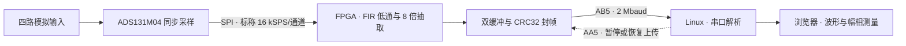

# ADS131M04 四通道低频信号采集

基于 **ADS131M04、Artix-7 FPGA 和 Linux** 的四通道低频采集系统，面向慢变电压观察、传感器信号调试和同频信号幅相比对。仓库包含可编辑的嘉立创EDA原理图及 PCB、Vivado 工程和 Linux 波形程序。



## 当前配置

| 项目 | 当前实现 |
|---|---|
| ADC | ADS131M04，四通道同步采样，24 位有符号码 |
| FPGA | XC7A35T-2FGG484，Vivado 2018.3 工程 |
| 波形处理 | 每通道标称 16 kSPS，经 257 抽头 FIR 低通及 8 倍抽取后输出 2 kSPS |
| 滤波设计 | FIR 通带设计约 800 Hz，抽取后奈奎斯特边界为 1 kHz |
| 串口 | 3.3 V TTL，2 Mbaud、8N1，AB5 发送，AA5 接收控制 |
| Linux 显示 | 四路波形，0.1、1、5、10 秒窗口，DC／AC 显示 |
| 测量 | 均值、交流有效值、峰峰值、指定频率的拟合幅值与相位差 |
| 电压单位 | 默认 ADC 码，导入各通道实测校准系数后显示伏特 |

长时基由 Linux 保留连续波形实现。选择 10 秒窗口时，串口仍上传标称 2 kSPS 的数据，屏端最多保留约 20,000 个样点／通道。

## 仓库内容

| 路径 | 内容 |
|---|---|
| [hardware](hardware/) | [嘉立创EDA专业版工程](hardware/four_channels_fpga.epro)，含 ADS131M04 原理图及 PCB |
| [fpga](fpga/) | [Vivado 工程](fpga/four_channels_adc.xpr)、Verilog、XDC 约束、FIR 系数及仿真源码 |
| [linux](linux/) | [串口波形程序](linux/adc_scope.py)、[测量与标定](linux/README_measurement.md)、[AA5 命令](linux/AA5.md) |

## 构建与接线

1. 下载 [板卡工程](hardware/four_channels_fpga.epro)，导入嘉立创EDA专业版查看原理图和 PCB。根据原理图和 FPGA 引脚约束核对采集板接口。
2. 用 Vivado 2018.3 打开 `fpga/four_channels_adc.xpr`。根据需要为 XCI 生成 FFT IP 输出产品，再运行综合、实现和 Generate Bitstream。
3. 将 FPGA 与 Linux 串口按下表连接，使用 3.3 V TTL 电平。

| FPGA 端 | Linux 串口端 | 用途 |
|---|---|---|
| AB5 | RXD | 四路波形上传 |
| AA5 | TXD | 暂停与恢复上传，可按需要连接 |
| GND | GND | 公共参考地 |

Linux 端需要 Python 3.8 或更新版本、`stty` 和浏览器。串口设备名按实际连接替换。

```sh
python3 linux/adc_scope.py /dev/ttyUSB0
```

在 Linux 屏幕打开 [本机波形页](http://127.0.0.1:8766/)。接收到有效帧后，页面显示数据来源、采样率和当前波形跨度。

## 低频测量示例

- **观察 1 Hz 波形**。选择 5 秒或 10 秒时基，分别观察约 5 个或 10 个周期。DC 视图保留直流分量，AC 视图从波形中减去当前窗口的均值。
- **比较两路同频信号**。将 CH0 接参考信号，输入已知激励频率，选择覆盖至少两个周期的窗口。拟合通过后，其他通道显示相对 CH0 的幅值比和相位差，正角表示领先。各曲线采用独立纵轴，幅值大小以测量表为准。
- **记录噪声底**。在实际前端施加有效的零差分输入，选择固定的窗口时长，记录四路 AC RMS。若已有实测零点与增益系数，可通过 `--calibration calibration.json` 换算为伏特。详见 [测量说明](linux/README_measurement.md)。

## 串口数据与控制

波形帧以 `ADSDW41!` 开头，固定 **412 字节**。帧头携带帧序号、采样率、首样点序号及点数。数据区包含 **32 组 CH0 至 CH3** 的交错样点，每个样点为小端 24 位补码。末尾 CRC32 覆盖帧头和数据区。Linux 校验 CRC 后，只拼接帧号和样点序号均连续的数据。

| AA5 命令（十六进制） | 行为 |
|---|---|
| `A5 70 00 FF` | 发完当前帧后暂停波形上传 |
| `A5 70 01 FE` | 从新样点组帧，恢复波形上传 |

上电默认上传。暂停期间 ADC 和 MCU 采集链继续工作。命令可从 Linux 串口发送，完整示例见 [AA5 控制说明](linux/AA5.md)。

## 验证与实物

- **数字链路**已做四通道 FIR 与独立卷积对照、串口波形解码与 CRC 检查、连续样点拼接，以及暂停和恢复仿真。
- **Linux 计算**已用合成信号核对 0.5 幅值比与 +45° 相位差，覆盖短窗口、异频测试和帧间断开。
- **FPGA 实现**中，AA5 版本完成布局布线并满足当前时序约束，建立裕量 +7.578 ns，保持裕量 +0.046 ns。
- **板级验收**待补实际接线后的屏幕显示、幅频响应、噪声底、最小可测输入和幅相准确度记录。实物照片后续补充。

## 许可

本项目原创源码和板卡设计采用 **GNU General Public License v3.0 only**。厂商工具、FFT IP 和第三方库适用各自许可。 [GPL-3.0 许可全文](LICENSE)
